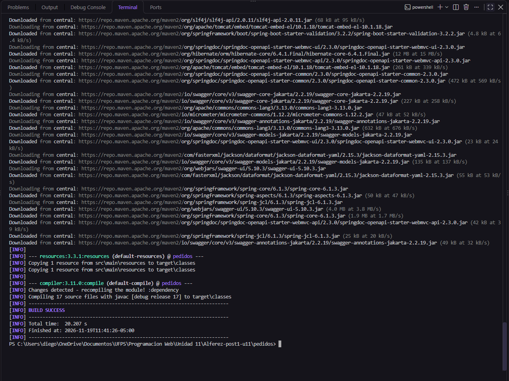
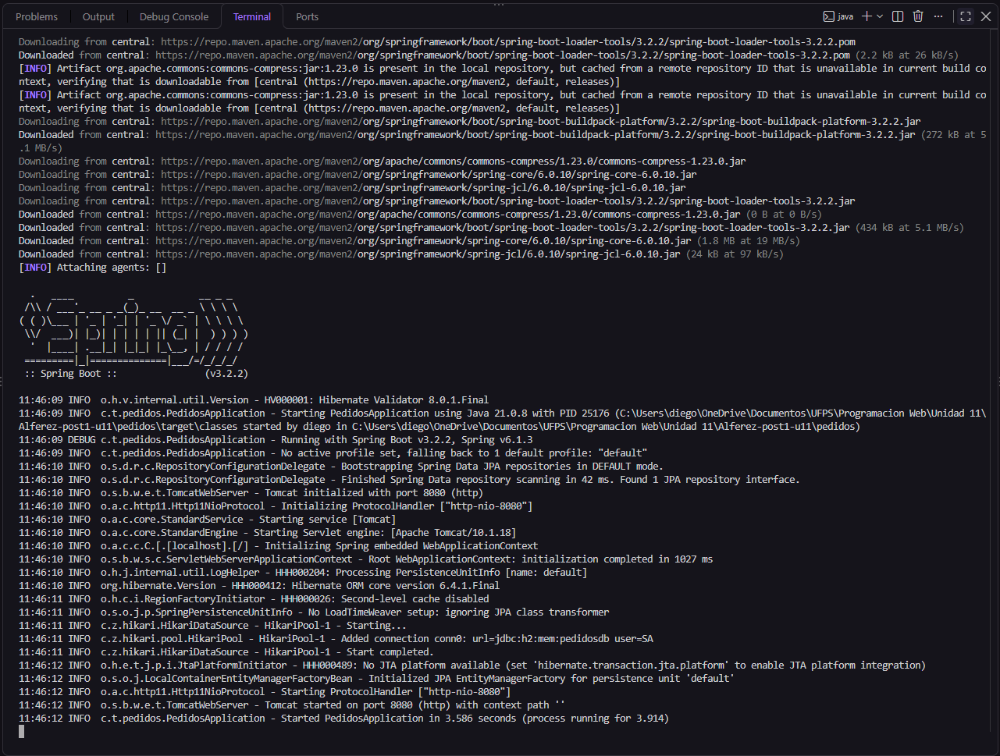
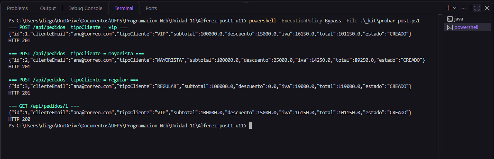
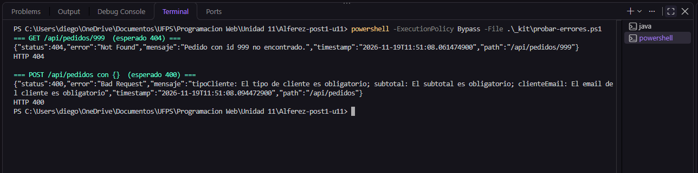
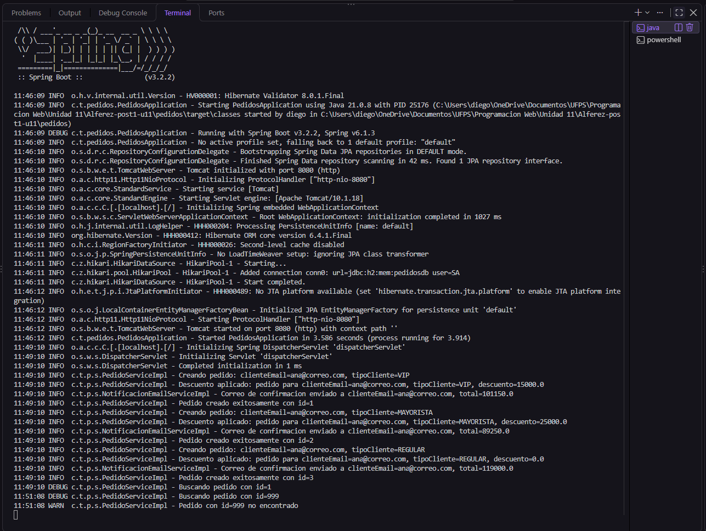
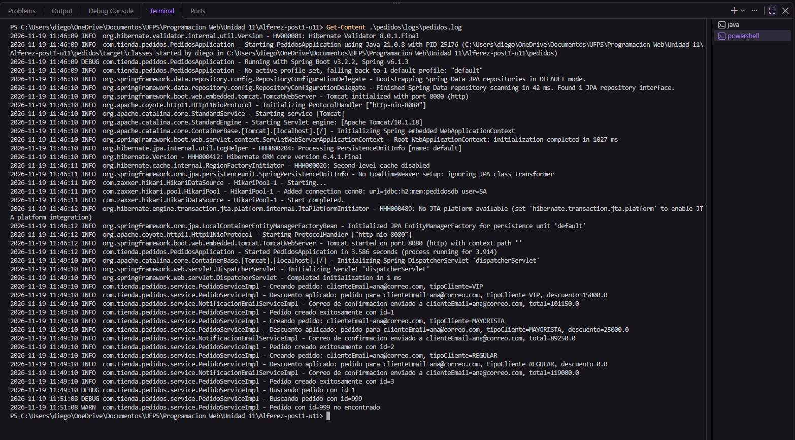
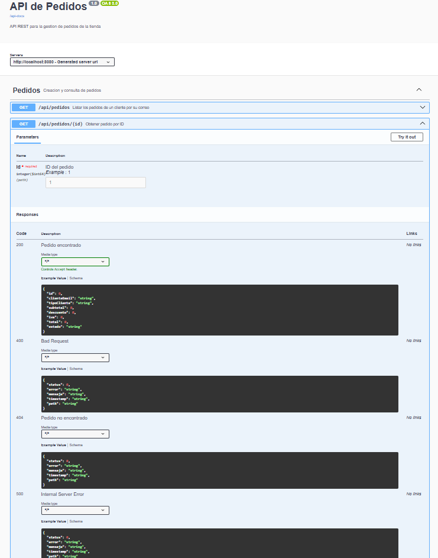

# Post-contenido — Unidad 11: Buenas Prácticas y Patrones de Diseño

**Autor:** Diego Alferez · Programación Web · UFPS

## Descripción

Repositorio del laboratorio de la Unidad 11 de Programación Web. Contiene un único proyecto Maven Spring Boot (`pedidos/`, paquete `com.tienda.pedidos`) que parte de un código funcional pero mal diseñado (SQL embebido en el controller, entidad JPA expuesta en la API, dependencias creadas con `new`) y lo refactoriza aplicando arquitectura en capas, SOLID (SRP y DIP), el patrón DTO con mapeo explícito y el patrón Strategy para el descuento por tipo de cliente. En la Parte 2 se endurece con manejo centralizado de errores (`@RestControllerAdvice`), logging con SLF4J/Logback y documentación con springdoc-openapi (Swagger UI).

**Tecnologías:** Java 17+, Spring Boot 3.2.2, Spring Data JPA, H2, Bean Validation, SLF4J/Logback, springdoc-openapi 2.3.0, Maven.

## Arquitectura resultante (diagrama de clases de texto)

```
                 Cliente HTTP
                      |
                      v
   +------------------------------------+
   | controller.PedidoController        |  recibe/devuelve DTOs, sin lógica
   +------------------------------------+
                      | depende de la INTERFAZ (DIP)
                      v
   +------------------------------------+        +--------------------------------+
   | service.PedidoService (interfaz)   |        | service.NotificacionService    |
   +------------------------------------+        |            (interfaz)          |
                      ^                          +--------------------------------+
                      | implementa                               ^
   +------------------------------------+   usa   +--------------------------------+
   | service.PedidoServiceImpl          |-------->| service.NotificacionEmailService|
   |  (repo, notificador, estrategias   |         |            Impl                |
   |   inyectados por constructor)      |         +--------------------------------+
   +------------------------------------+
        |                    |
        | usa                | usa Map<String, EstrategiaDescuento>
        v                    v
   +--------------------+   +---------------------------------------+
   | repository.        |   | strategy.EstrategiaDescuento (interf.)|
   |  PedidoRepository  |   |   ^            ^              ^       |
   |  (JpaRepository)   |   | DescuentoRegular DescuentoVip DescuentoMayorista
   +--------------------+   +---------------------------------------+
        |
        v
   +--------------------+      dto.PedidoRequestDTO  (entrada, con validaciones)
   | entity.Pedido      |      dto.PedidoResponseDTO (salida, sin notasInternas)
   +--------------------+
                                exception.GlobalExceptionHandler (@RestControllerAdvice)
                                exception.ApiError · exception.RecursoNoEncontradoException
```

## Violaciones SOLID identificadas en el código de partida y cómo se corrigieron

| # | Violación en el código de partida | Corrección |
|---|-----------------------------------|------------|
| 1 | **SRP**: `crearPedido` validaba, calculaba el descuento, construía el SQL, persistía, notificaba y registraba el log (6 responsabilidades en un método). | Cada responsabilidad pasó a su clase: validación en `PedidoRequestDTO` (Bean Validation), descuento en `strategy`, persistencia en `PedidoRepository`, orquestación en `PedidoServiceImpl`, notificación en `NotificacionService`, errores en `GlobalExceptionHandler`. |
| 2 | **DIP**: `NotificacionEmailService` se creaba con `new` dentro del controller. | `PedidoServiceImpl` recibe `NotificacionService` (interfaz) por constructor; el controller depende de la interfaz `PedidoService`. Ninguna clase instancia sus colaboradores con `new`. |
| 3 | **Sin capa de acceso a datos**: SQL concatenado en el controller (además vulnerable a inyección SQL). | `PedidoRepository extends JpaRepository`; no queda ninguna sentencia SQL escrita a mano. |
| 4 | **Entidad expuesta** (`notasInternas` salía al cliente). | `PedidoRequestDTO` / `PedidoResponseDTO` con mapeo explícito; la respuesta nunca incluye `notasInternas`. |
| 5 | **Manejo de errores disperso**: `try/catch` con `println` que devolvía `null` (200 con cuerpo vacío para un id inexistente). | `RecursoNoEncontradoException` + `GlobalExceptionHandler` (404, 400 y 500 con `ApiError`); el controller no tiene `try/catch`. |
| 6 | **OCP**: el descuento era un `if/else if` dentro del controller. | Patrón Strategy: agregar un tipo de cliente nuevo es crear una clase `@Component("NUEVO")`, sin tocar `PedidoServiceImpl`. |

## Decisiones de diseño

### Parte 1
- **`JpaRepository` en vez de mantener `JdbcTemplate`:** el SQL concatenado exponía a inyección SQL y obligaba a mantener las sentencias sincronizadas con la entidad. Spring Data JPA da el CRUD sin escribir SQL y genera consultas derivadas (`findByClienteEmail`) con seguridad de tipos.
- **Strategy en vez de un segundo patrón (Factory) para la conversión a DTO:** el descuento tiene una variación real de comportamiento y puede crecer (OCP); la conversión entidad-DTO es un mapeo 1:1 sin lógica condicional, por lo que se resuelve con un método privado `toResponseDTO()` en el servicio, evitando sobre-ingeniería.

### Parte 2
- **El registro del descuento aplicado vive en el servicio, no en cada Strategy:** un único mensaje INFO en `PedidoServiceImpl` deja un solo punto de auditoría por pedido en lugar de dispersarlo en tres clases.
- **`notasInternas` nunca se registra en los logs ni se expone en el DTO:** es información operativa de logística; los logs solo incluyen identificadores (id, clienteEmail, tipoCliente) y montos, ya que el archivo puede compartirse con soporte y se retiene 30 días.

## Endpoints

| Método | Ruta | Descripción | Respuestas |
|--------|------|-------------|------------|
| POST | `/api/pedidos` | Crea un pedido y aplica el descuento según `tipoCliente` | 201, 400 |
| GET | `/api/pedidos/{id}` | Obtiene un pedido por id | 200, 404 |
| GET | `/api/pedidos?clienteEmail=` | Lista los pedidos de un cliente | 200, 400 |

Descuentos: REGULAR 0 %, VIP 15 %, MAYORISTA 25 %; IVA 19 % sobre el valor con descuento.

## Cómo compilar y ejecutar

1. Clonar el repositorio: `git clone https://github.com/diegoalferez/Alferez-post1-u11.git`
2. Entrar a la carpeta del proyecto: `cd Alferez-post1-u11/pedidos`
3. Compilar: `./mvnw compile` (en Windows: `.\mvnw.cmd compile`)
4. Ejecutar: `./mvnw spring-boot:run` (en Windows: `.\mvnw.cmd spring-boot:run`)
5. Probar los endpoints con Postman o curl en `http://localhost:8080/api/pedidos`
   ```
   curl -X POST http://localhost:8080/api/pedidos -H "Content-Type: application/json" \
        -d '{"clienteEmail":"ana@correo.com","tipoCliente":"VIP","subtotal":100000}'
   ```
6. Consultar los logs en consola y en `pedidos/logs/pedidos.log`
7. Abrir la documentación interactiva en `http://localhost:8080/swagger-ui.html`

## Capturas de pantalla

### Parte 1
**Checkpoint 1 — DTOs y PedidoRepository (compilación exitosa, sin SQL embebido)**



**Checkpoint 2 — PedidoService con DIP (la aplicación inicia con las dependencias inyectadas por constructor)**



**Checkpoint 3 — Strategy funcionando con los tres tipos de cliente (VIP 15 %, MAYORISTA 25 %, REGULAR 0 %)**



### Parte 2
**Checkpoint 1 — Manejo de errores 404 y 400 con ApiError**



**Checkpoint 2 — Logs SLF4J en consola y en archivo**





**Checkpoint 3 — Swagger UI con los endpoints documentados**


